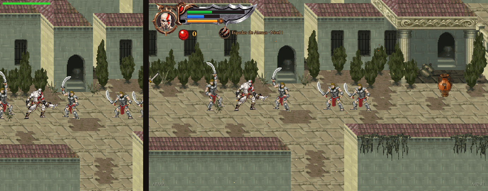
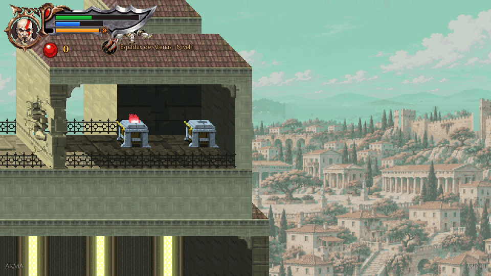
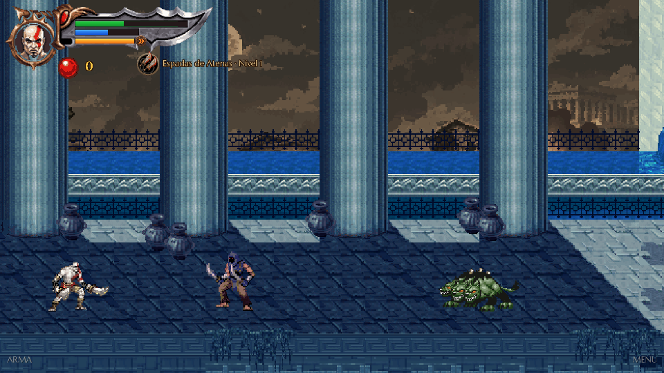
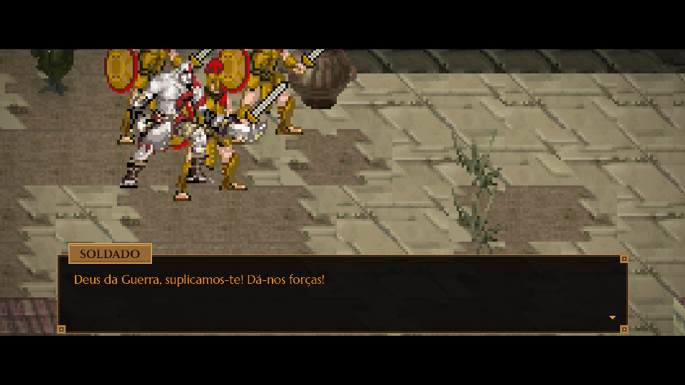
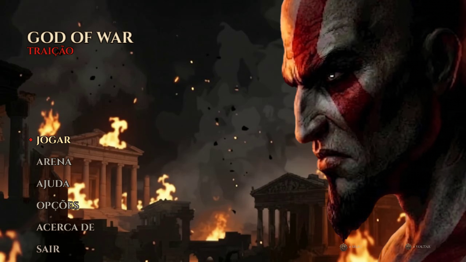
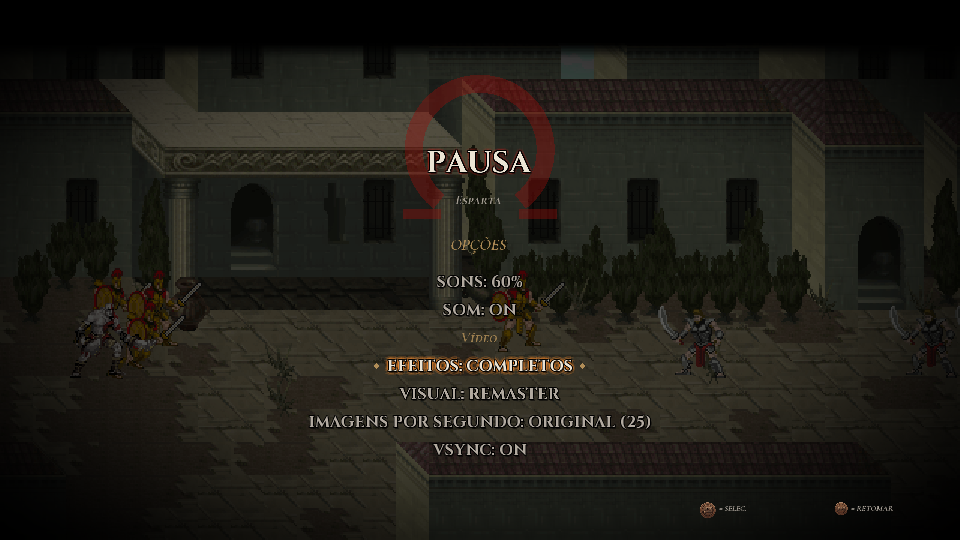
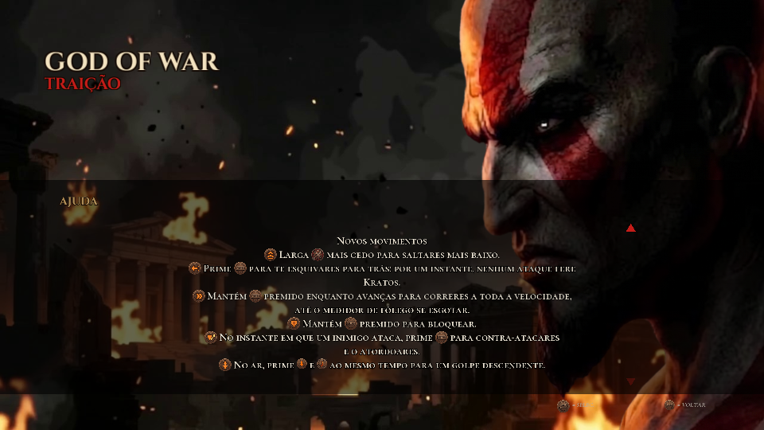
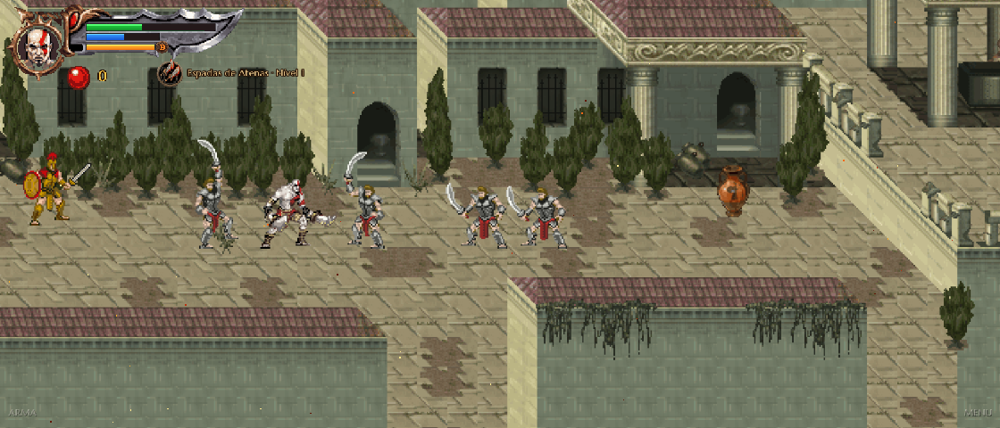

# Lamina Rubra

Motor novo, escrito do zero, para rodar o jogo J2ME *God of War: Betrayal* (Glu Mobile, 2007) no PC e no Android, com os arquivos
originais do jogo que **você já tem**: um modo **clássico**, fiel ao celular, e um **remaster** em tela larga.

> **O Lamina Rubra não traz o jogo.** Nenhum gráfico, som, texto ou mapa do jogo vem junto. Para jogar, você precisa do arquivo
> `.jar` original do jogo (MIDlet versão 1.4.20, do Sony Ericsson K800i, ou 1.4.8). O motor lê esse arquivo na hora de jogar e não o envia para lugar nenhum.

## O que muda em relação ao jogo original

O **modo clássico** é o jogo do celular como ele era: 240×320, a física, a inteligência dos inimigos, os chefes, os menus e as
falas reconstruídos a partir do jogo original. O **remaster** usa a mesma lógica e muda a apresentação e o controle:

| | no celular (2007) | no Lamina Rubra (remaster) |
|---|---|---|
| **Tela** | 240×320, retrato | 1080p em tela larga (16:9, 21:9, 16:10 ou 4:3), mostrando mais do nível nos lados, sem esticar |
| **Fluidez** | 25 quadros por segundo | 60, 90, 120, 144, 165, 240 ou sem limite, com o movimento interpolado; VSync |
| **Cenário** | céu liso e prédios do celular | fundos pintados com parallax (a cidade de Esparta, cidade em chamas e ruínas) |
| **Interface** | barras do celular | HUD novo de bronze e mármore, menus e telas novos, caixa de fala com retrato de quem fala, câmera de cutscene nas falas |
| **Controle** | teclado numérico | teclado e controle (gamepad), com botões próprios para pular, atacar, interagir, bloquear e esquivar; as teclas e os botões podem ser trocados no jogo, e os ícones mostram a tecla ou o botão de verdade |
| **Movimentos** | os do original | e mais: esquiva, corrida com fôlego, contra-ataque (bloquear no instante do golpe), golpe descendente e pulo de altura variável |
| **Som** | três músicas MIDI | música, efeitos e vozes novos, com volume de música e de sons |
| **Ajuda** | o texto do celular | página nova com os movimentos novos e dicas na primeira vez que cada um faz falta |
| **Opções** | som e idioma | Opções também dentro da pausa (som, vídeo, jogo, controles), modo difícil, 6 idiomas |
| **Abertura** | — | vídeo de prólogo |
| **Conquistas** | — | 26 conquistas (bronze, prata e ouro), com aviso ao desbloquear e uma tela própria no menu e na pausa |

No modo clássico nada disso muda: é o jogo original, só que no PC ou no Android.

## Imagens

| | |
|---|---|
|  |  |
| Nível 1: a cidade pintada ao fundo | Nível 5: cidade em chamas atrás das colunas |
|  |  |
| Falas com câmera de cutscene | Menu principal |
|  |  |
| Opções dentro da pausa | Ajuda: novos movimentos, com o botão de cada um |

*Em 21:9, o nível se abre ainda mais para os lados.*

## Baixar

Na página de [releases](../../releases/latest):

| arquivo | para | precisa |
|---|---|---|
| `lamina-rubra-1.0.15-windows-x64-setup.exe` | **Windows** (instalador) | nada (Java embutido) |
| `lamina-rubra-1.0.15-x86_64.AppImage` | **Linux** (um arquivo só) | nada (Java embutido) |
| `lamina-rubra-1.0.15.apk` | **Android** 7.0 ou mais novo | — |
| `lamina-rubra-1.0.15.zip` | PC (Linux e Windows) | Java 21 ([adoptium.net](https://adoptium.net/)) |
| `lamina-rubra-1.0.15-linux-x64.tar.gz` | Linux | nada (Java embutido) |

O remaster completo (interface, fundos, som e o vídeo do prólogo) já vem nos pacotes; o jogo abre nele.

## PC

- **Windows**: rode o instalador `.exe` (não pede administrador; cria atalhos no Menu Iniciar e na área de trabalho).
- **Linux**: marque o `.AppImage` como executável (`chmod +x` ou nas propriedades do arquivo) e abra com dois cliques.

Na primeira abertura, uma janela pede o `.jar` do jogo; ele é conferido (avisa se for de outra versão) e lembrado para as próximas
vezes. O jogo abre no remaster, em tela cheia 1080p (F11 alterna com janela).

Nos pacotes `.zip` e `.tar.gz`, o jogo abre por `bin/lamina-rubra` (Linux) ou `bin\lamina-rubra.bat` (Windows); o caminho do `.jar`
também pode vir na linha de comando (`bin/lamina-rubra /caminho/do/gow.jar`) ou como `jar=/caminho/do/gow.jar` em
`~/.config/gow-motor/gow-motor.properties` (no Windows, `C:\Users\<você>\.config\gow-motor\gow-motor.properties`). O arquivo
`gow-motor.properties.exemplo` do pacote mostra as outras opções.

O save, a configuração e os arquivos do remaster ficam em `~/.config/gow-motor/`.

### Controles no teclado (remaster)

| ação | tecla |
|---|---|
| andar, subir, descer | setas (ou WASD) |
| pular | Espaço |
| atacar (golpe, agarrar, magia) | J, X ou Enter |
| interagir (baú, alavanca, inimigo atordoado) | E |
| bloquear (segurado) | Shift |
| esquiva / corrida (segurando para a frente) | Ctrl |
| trocar de arma | Q |
| evolução | U |
| pausa / voltar | Esc |
| tela cheia | F11 ou Alt+Enter |

Controle (gamepad) também funciona: A pula, X ataca, B interage, LT bloqueia, RT esquiva, RB troca a arma, Start pausa.

As teclas e os botões podem ser trocados em **Opções → Controles → Teclado** (ou **Comando**), também pela pausa: escolha a ação,
aperte a tecla nova e pronto (Esc e F11 ficam fixos). "Repor predefinições" volta ao padrão.

## Android

1. Instale o `.apk` (permita instalar de fontes desconhecidas, se o aparelho pedir). Se tiver a 1.0.0, desinstale-a antes; as versões a partir da 1.0.1
   atualizam direto.
2. Na primeira abertura, toque em **Escolher o arquivo .jar** e escolha o `.jar` do jogo. Ele é conferido (outra versão é avisada) e
   copiado para a pasta privada do app; das próximas vezes o jogo abre direto. Se o jogo não abrir com o arquivo escolhido, o app
   volta à tela de escolha mostrando o erro. Para trocar de `.jar`, limpe os dados do app nas configurações do Android.
3. Na primeira abertura o app também prepara os arquivos do remaster (alguns segundos). O vídeo do prólogo toca no reprodutor do
   Android; um toque o pula.
4. Controles de toque em pixel art, só durante a partida: o direcional à esquerda e, à direita, os botões com o ícone de cada ação
   (pular, atacar, agir, arma, bloquear, esquiva; evolução e pausa no alto). O botão da ação pedida pisca (agir perto de um baú, pular
   embaixo de uma corda); nas falas, um toque em qualquer lugar avança. Nos menus, toque no item para escolher e toque de novo para
   confirmar; na evolução, deslize para mudar de arma e segure para evoluir. Em **Opções → Controles** dá para mudar o tamanho e a
   opacidade dos botões, ligar o modo canhoto, deixar o direcional flutuante e desligar a vibração. O botão voltar do Android pausa e
   volta nos menus.

Limitação desta versão: no Android, a música MIDI do modo clássico não toca (o Android não tem sintetizador MIDI). Relatos de
problema são bem-vindos nas [issues](../../issues).

## Créditos

Os fundos de cidade em chamas e de ruínas que vêm nos kits do remaster são arte do **Fenaky Lab**.

## Aviso legal

Lamina Rubra é um projeto de fãs, sem fins lucrativos e sem nenhuma ligação com a Sony Interactive Entertainment, o Santa Monica Studio
ou a Glu Mobile. *God of War* é marca dos seus donos; o nome aparece aqui só para dizer com qual jogo o motor é compatível. O motor foi
escrito do zero e não contém código, gráficos, sons, textos nem mapas do jogo. As imagens desta página mostram o motor rodando com
uma cópia do jogo; os personagens e o cenário do jogo pertencem aos seus donos. Use somente uma cópia do jogo que você tenha obtido
legalmente.
